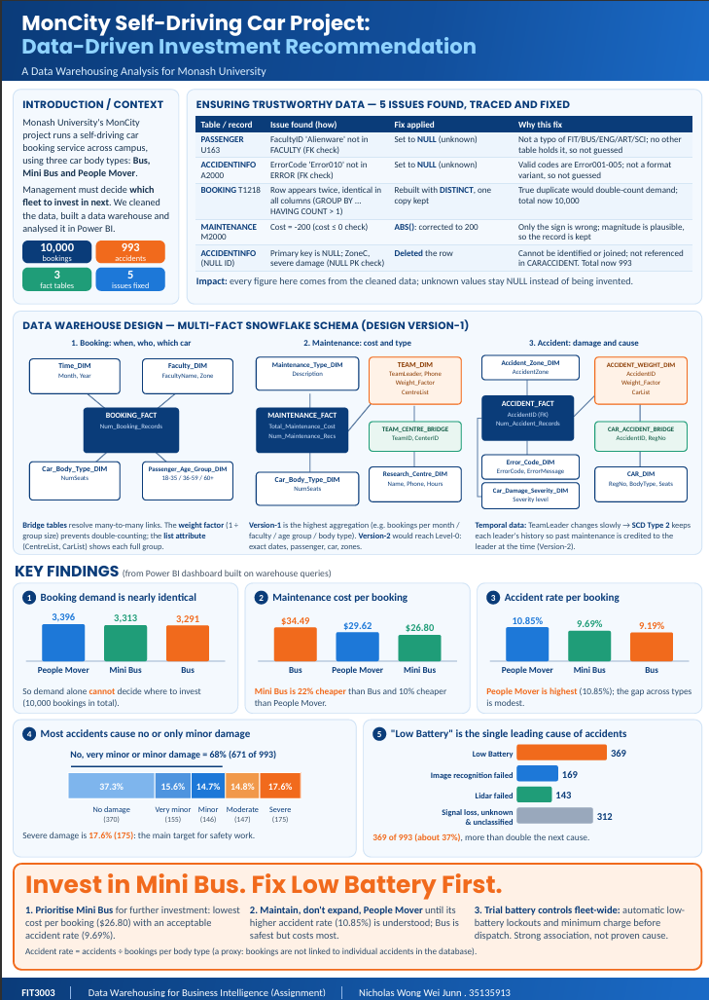
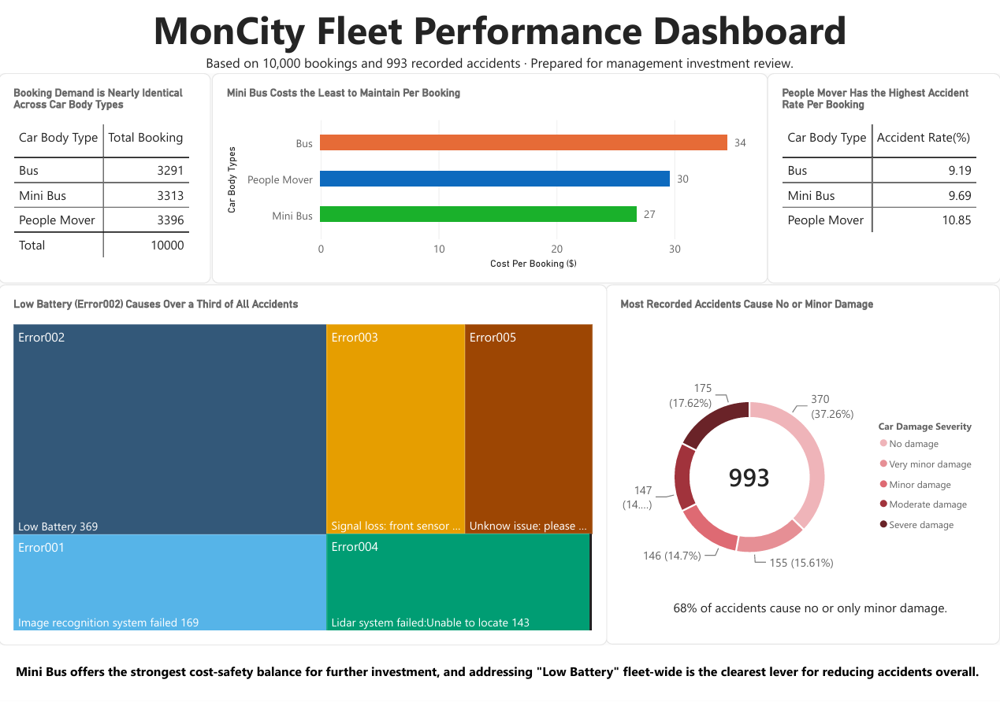

# MonCity Smart-City Data Warehouse: Self-Driving Car Fleet Analytics

**End-to-end data warehousing project: clean an operational database, design a multi-fact snowflake schema, implement it in Oracle SQL, and turn it into an investment recommendation in Power BI.**

Built as part of *FIT3003 Data Warehousing for Business Intelligence* at Monash University Malaysia.

> **Business question:** Monash's MonCity self-driving car service runs three car body types (Bus, Mini Bus, People Mover). Which fleet should management invest in next?

> **Answer:** Invest in the **Mini Bus**, and fix **Low Battery** failures fleet-wide before expanding any fleet.

---

## At a Glance

| 10,000 | 993 | 3 | 5 |
|:---:|:---:|:---:|:---:|
| bookings analysed | accidents analysed | fact tables | data-quality issues found and fixed |

**Tech stack:** Oracle SQL · Dimensional modelling (star/snowflake) · Power BI

---

## Preview

| Poster | Dashboard |
|:---:|:---:|
|  |  |

---

## Repository Contents

| File | Description |
|---|---|
| `poster/` | One-page poster summarising the problem, data quality work, warehouse design, findings and recommendation |
| `report/` | Full report: data cleaning (C2), schema design (C3), SQL implementation (C4), data analysis (C5) |
| `dashboard/` | Power BI dashboard built on queries against the warehouse |

**Suggested reading order:** poster (2 min) → dashboard (3 min) → report (for the detail).

**Live dashboard:** [MonCity Fleet Performance Dashboard](https://app.powerbi.com/groups/me/reports/3ff80521-c2b9-4df3-9bc3-edf1ce6f4651?ctid=ef7a487a-77ca-410a-803d-e426b62a587f&pbi_source=linkShare)

---

## Project Workflow

### 1. Data Cleaning: five issues found, traced and fixed

Each issue was found with an exploration query, traced to confirm the root cause, then fixed with a documented before/after check. The principle throughout: **never invent data**. Unknown values become `NULL` instead of guesses.

| # | Table | Issue | How it was found | Fix |
|---|---|---|---|---|
| 1 | `PASSENGER` | `FacultyID = 'Alienware'` is not a valid faculty | FK check against `FACULTY` | Set to `NULL`; not a typo of any valid faculty, so not guessed |
| 2 | `ACCIDENTINFO` | `ErrorCode = 'Error010'` does not exist | FK check against `ERROR` | Set to `NULL`; valid codes are Error001 to Error005 |
| 3 | `BOOKING` | Booking `T1218` appears twice, identical in every column | `GROUP BY ... HAVING COUNT(*) > 1` | Rebuilt table with `DISTINCT`; total is now 10,000 |
| 4 | `MAINTENANCE` | `MaintenanceCost = -200` | `cost <= 0` check | `ABS()`; only the sign was wrong, magnitude is plausible |
| 5 | `ACCIDENTINFO` | Primary key is `NULL` | `NULL` primary key check | Deleted; row could not be identified or joined and was not referenced elsewhere. Total is now 993 |

### 2. Data Warehouse Design: multi-fact snowflake schema (Design Version-1)

Three business processes are modelled as three fact tables.

| Fact table | Measures | Dimensions |
|---|---|---|
| `BOOKING_FACT` | `Num_Booking_Records` | Time, Faculty, Car Body Type, Passenger Age Group |
| `MAINTENANCE_FACT` | `Total_Maintenance_Cost`, `Num_Maintenance_Records` | Maintenance Type, Car Body Type, Team (→ Research Centre via bridge) |
| `ACCIDENT_FACT` | `Num_Accident_Records` | Accident Zone, Error Code, Car Damage Severity, Accident (→ Car via bridge) |

**Design decisions worth highlighting:**

- **Bridge tables for many-to-many relationships.** A maintenance team can belong to several research centres (`TEAM_CENTRE_BRIDGE`), and an accident can involve several cars (`CAR_ACCIDENT_BRIDGE`).
- **Weight factors to prevent double-counting.** A weight factor (1 ÷ group size) is stored on the dimension connected to the fact table (`TEAM_DIM`, `ACCIDENT_WEIGHT_DIM`), so measures stay correct when sliced by research centre or car.
- **List-aggregate attributes.** `CentreList` and `CarList`, built with `LISTAGG`, show each full group directly on the dimension without extra joins.
- **Version-1 is the highest aggregation level** (e.g. bookings per month, faculty, age group and body type). The report also specifies the changes needed to reach **Level-0** granularity in Version-2: exact dates, individual passengers and cars, degenerate dimensions (`BookingID`, `MaintenanceID`, `AccidentID`).
- **Slowly Changing Dimensions.** The report compares SCD Types 0, 1, 2, 3, 4 and 6, and recommends **Type 2** for `TEAM_DIM.TeamLeader` so past maintenance is credited to the leader at the time (applicable once Version-2 adds a maintenance date).

### 3. Implementation in Oracle SQL

All dimension, bridge and fact tables were built with `CREATE TABLE AS SELECT` from the cleaned operational tables, with table structures documented in the report.

### 4. Analysis and Recommendation in Power BI

The dashboard answers the investment question across five views: booking demand, maintenance cost per booking, accident rate, damage severity, and accident cause.

---

## Key Findings

| Finding | Result |
|---|---|
| **Demand is nearly identical across fleets** | People Mover 3,396 · Mini Bus 3,313 · Bus 3,291, so demand alone cannot decide where to invest |
| **Mini Bus is cheapest to maintain** | $26.80 per booking vs. $29.62 (People Mover) and $34.49 (Bus). Mini Bus is 22% cheaper than Bus and 10% cheaper than People Mover |
| **Accident rates differ only modestly** | Bus 9.19% · Mini Bus 9.69% · People Mover 10.85% |
| **Most accidents are low severity** | 68% (671 of 993) cause no, very minor or minor damage. Severe damage is 17.6% (175) |
| **Low Battery is the leading accident cause** | 369 of 993 accidents (about 37%), more than double the next cause |

## Recommendations

1. **Prioritise Mini Bus for further investment.** Lowest cost per booking with an acceptable accident rate.
2. **Maintain, don't expand, People Mover** until its higher accident rate is understood. Bus is the safest but costs the most.
3. **Trial fleet-wide battery controls**, such as automatic low-battery lockouts and a minimum charge before dispatch.

---

## Limitations (stated up front)

- **Accident rate is a proxy.** It is calculated as accidents ÷ bookings per body type, because the database does not link individual bookings to individual accidents. It is not a measured per-trip probability.
- **One accident has no car recorded**, so car-level accident figures cover 992 of 993 accidents.
- **Low Battery is a strong association, not a proven cause**, which is why the recommendation is a trial rather than a rollout.

---

## Skills Demonstrated

- **Data quality:** referential integrity checks, duplicate detection, domain and sanity checks, and defensible cleaning decisions (when to repair, when to nullify, when to delete)
- **Dimensional modelling:** multi-fact snowflake schemas, bridge tables, weight factors, degenerate dimensions, granularity levels, determinant dimension evaluation
- **Temporal data:** slowly changing dimension types and a justified choice for a real attribute
- **SQL (Oracle):** DDL, `CREATE TABLE AS SELECT`, `LISTAGG`, aggregate and analytical queries
- **BI and communication:** Power BI dashboard design, plus translating analysis into a clear management recommendation with honest caveats

---

## Author

**Nicholas Wong Wei Junn**
Monash University Malaysia

- LinkedIn: [Nicholas Wong](https://www.linkedin.com/in/nicholas-wei-junn-wong-ba52b8199/)
- Email: totowong0810@gmail.com

---

*Academic project completed for FIT3003 (Semester 2, 2026). All data comes from the unit's provided MonCity dataset.*
